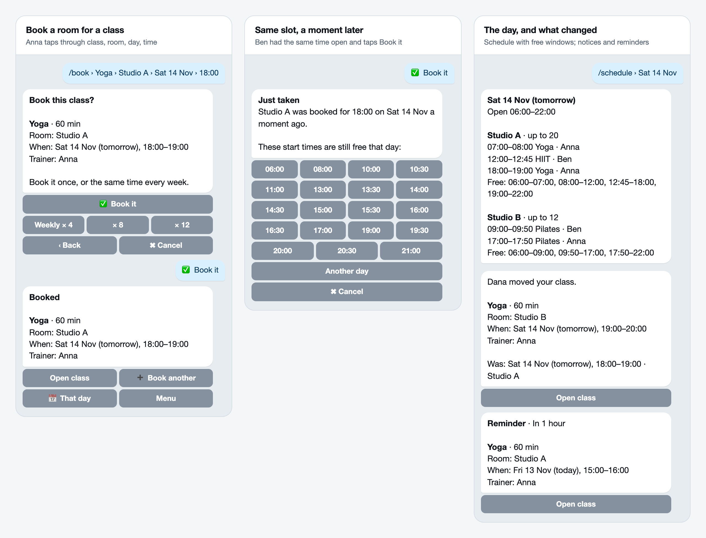
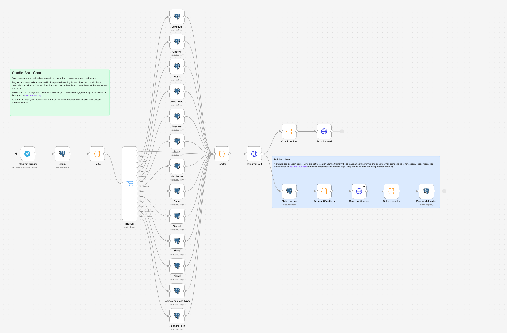

# n8n Telegram class booking

[](https://github.com/lunox-work/n8n-telegram-class-booking/actions/workflows/test.yml)

A Telegram bot for a fitness studio, built with n8n and PostgreSQL. Trainers and admins see the schedule and the free times, book rooms for classes, move and cancel them, and get reminders. A room is never booked twice, and a trainer is never booked into two rooms at once.

Import four workflows and run one SQL file. No community nodes, no paid n8n features.



<sub>Rendered from the messages the bot sent during a test run. It is a drawing of the chat, not a Telegram screenshot.</sub>

## What it covers

| Asked for | What you get |
| --- | --- |
| View schedules and available time slots | `/schedule` shows any day, room by room, with the classes and the free windows. The booking flow only offers start times that are still free. |
| Book, reschedule and cancel classes | Tap through class type, room, day and time. Move or cancel from `/my`. Book once or as a weekly series of 4, 8 or 12. |
| Multiple training rooms | Any number of rooms. Admins add, rename and switch them off in the chat. |
| Prevent double bookings | Two PostgreSQL exclusion constraints: one per room, one per trainer. They hold for simultaneous taps, for several n8n workers and for manual SQL. |
| Notifications and reminders | Reminders 24 hours and 1 hour before a class, a morning summary, and a message whenever someone else books, moves or cancels your class. |
| Role-based access | Admin and trainer. New people wait until an admin lets them in. The check is in the database, so a forged button gets nowhere. |
| PostgreSQL or Google Calendar | PostgreSQL is the source of truth. A calendar feed lets Google, Apple and Outlook calendars show the schedule, read-only. |

Also included: an audit trail of who booked, moved and cancelled what, an error workflow that tells the admins when a run fails, and a test suite that runs the real workflows.

## Start it with Docker

For a new setup. You need Docker, a bot token from [@BotFather](https://t.me/BotFather), and a public `https` address that reaches this machine (your domain or a tunnel), because Telegram delivers updates to a webhook.

```bash
git clone https://github.com/lunox-work/n8n-telegram-class-booking.git
cd n8n-telegram-class-booking
cp .env.example .env      # fill in the token, the address, studio name and time zone
docker compose up -d
```

This starts PostgreSQL and n8n, installs the schema, creates the two credentials, imports the four workflows and publishes them. Open your bot in Telegram and send `/start` straight away: the first person to do so becomes the admin.

The n8n editor is on port 5678. It asks you to create an owner account on the first visit.

## Add it to your n8n

For n8n Cloud or an n8n you already run. You need a PostgreSQL 13+ database that n8n can reach (Supabase, Neon and RDS all work).

1. Run [`db/install.sql`](db/install.sql) on the database: `psql "$DATABASE_URL" -f db/install.sql`, or paste it into your provider's SQL editor.
2. Tell it about your studio:

   ```sql
   SELECT studio.setup(
     bot_token    => '123456:ABC...',            -- from @BotFather
     studio_name  => 'Flex Studio',
     timezone     => 'Europe/Berlin',
     calendar_url => 'https://YOUR-N8N/webhook/studio-calendar'
   );
   ```

3. In n8n, create two credentials with exactly these names, so the imported nodes find them:
   - **Studio Bot Postgres** (type Postgres): your database.
   - **Studio Bot Telegram** (type Telegram API): the same bot token.
4. Import the four files in [`workflows/`](workflows) (new workflow, menu, Import from file), in any order. Each node picks up the credential with the matching name.
5. In workflows 1, 2 and 3 open Settings and set Error Workflow to **Studio Bot · 4 Error alerts**. Optional.
6. Publish (n8n 2) or activate (n8n 1) all four.
7. Send `/start` to your bot straight away: the first person to do so becomes the admin.

## Using the bot

| | Trainer | Admin |
| --- | :---: | :---: |
| See the schedule and free times of every room | yes | yes |
| Book a class for yourself, once or weekly | yes | yes |
| Move or cancel your own classes | yes | yes |
| Subscribe a calendar to the schedule | yes | yes |
| Book for another trainer | | yes |
| Move or cancel anyone's class | | yes |
| Let people in, change roles, block | | yes |
| Add, rename, switch off rooms and class types | | yes |

Commands: `/start`, `/schedule`, `/book`, `/my`, `/calendar`, `/help`, and for admins `/people`, `/rooms`, `/classtypes`. Everything is also reachable by buttons from the menu.

To show the commands in Telegram's menu, send this to @BotFather after `/setcommands`:

```
schedule - Rooms, classes and free times for a day
book - Book a room for a class
my - Your upcoming classes
calendar - Links for Google, Apple or Outlook calendars
help - What this bot does
```

## How it works



```
Telegram ─► Begin ─► Route ─► Branch ─► one Postgres function ─► Render ─► Telegram
            dedupe    which     per       checks the role,        writes
            who is    screen    screen    does the work           the reply
            this
```

**PostgreSQL decides.** The rule against double booking is not an `IF` node. It is a constraint on the table:

```sql
CONSTRAINT booking_room_free
  EXCLUDE USING gist (room_id WITH =, during WITH &&) WHERE (status = 'confirmed'),
CONSTRAINT booking_trainer_free
  EXCLUDE USING gist (trainer_id WITH =, during WITH &&) WHERE (status = 'confirmed')
```

Booking does not check and then insert. It inserts and lets the constraint answer, so two people confirming the same slot in the same instant cannot both win. The function catches the refusal and returns the times that are still free in that room on that day, and the bot offers them straight away. Moving a class is a single `UPDATE`, so the old slot is released and the new one taken together.

**The buttons carry the state.** A booking in progress is not stored anywhere. Each button holds every choice so far, for example `b:c2:r1:d20261114:t0900` (class type 2, room 1, 14 November, 09:00). There is no session row to expire or to fall out of step with the screen. When a slot is lost, the bot still knows the class, room and day from the button that was tapped. Back is the same data with the last choice removed. Only typed answers, such as the name of a new room, use a small state table.

**n8n routes and talks.** Each branch of the Switch node is one call such as `SELECT studio.book($1::jsonb)`. Chat input reaches the database only as a bound parameter. All wording lives in the Render node. To act on an event, add nodes after its branch: after **Book**, for example, to post new classes to a channel.

**Messages for other people go through an outbox.** When an admin moves a trainer's class, the notice is written to `studio.outbox` in the same transaction as the change and sent right after the reply. A message that fails is retried by the notifier; one that cannot be delivered because the person blocked the bot is marked and left alone.

**Four workflows**

| File | What it does |
| --- | --- |
| [`1-chat.json`](workflows/1-chat.json) | Every message and button tap. |
| [`2-notifier.json`](workflows/2-notifier.json) | Every 5 minutes: reminders, the morning summary, retries. |
| [`3-calendar-feed.json`](workflows/3-calendar-feed.json) | A webhook that serves the schedule as an iCalendar feed. |
| [`4-error-alerts.json`](workflows/4-error-alerts.json) | Tells the admins on Telegram when a run fails. |

## Settings

Change any of these at any time with `SELECT studio.setup(name => value);`. Only what you pass is changed.

| Setting | Default | Meaning |
| --- | --- | --- |
| `studio_name` | `Studio` | Shown in the menu and as the calendar's name. |
| `timezone` | `UTC` | All times in the chat are in this zone. |
| `opens`, `closes` | `06:00`, `22:00` | Classes must start and end inside these hours. |
| `closed_weekdays` | `{}` | Days without classes: `'{7}'` closes Sundays (1 is Monday). |
| `slot_minutes` | `30` | Start times are offered every 15, 30 or 60 minutes. |
| `horizon_days` | `60` | How far ahead a class can be booked. |
| `reminder_minutes` | `{1440,60}` | Minutes before a class at which the trainer is reminded. |
| `digest_time` | `07:00` | When the morning summary goes out. To switch it off: `UPDATE studio.settings SET digest_time = NULL;` |
| `notify_admins` | `true` | Tell admins when a trainer books, moves or cancels. |
| `calendar_url` | none | Address of the calendar webhook. Without it the Calendar button is hidden. |
| `bot_token` | none | The bot token, used to send replies. |

## Changing it

- **Wording, language, emoji:** [`src/render.js`](src/render.js) and [`src/notify.js`](src/notify.js) hold every sentence. Edit them and run `node scripts/build.mjs`, or edit the Render node in the editor.
- **Rules:** [`db/install.sql`](db/install.sql). Run the file again after editing; it replaces the functions and leaves your data alone.
- **New steps:** add nodes in n8n after a branch. The workflow files are ordinary exports.

The Code nodes are generated from the files in `src/` so they can be read and tested as normal JavaScript. You do not need Node.js to use the bot.

## Tests

```bash
npm test            # router, screens, workflow files: no Docker needed
npm run test:e2e    # starts n8n, Postgres and a Telegram stand-in, plays 22 scenarios
```

The end-to-end suite imports the workflows into a real n8n, points the Telegram credential at [`test/mock-telegram.mjs`](test/mock-telegram.mjs) and behaves like people using the bot: it posts updates to n8n's webhook and reads the replies. The stand-in rejects what the real Bot API rejects (bad HTML, button data over 64 bytes, edits that change nothing). The scenarios include two people confirming the same slot at the same moment, a double tap, forged buttons from a trainer, a reminder arriving once, and a failing run reaching the admins.

Both suites run on every push in GitHub Actions. Last run: n8n 2.47.5, PostgreSQL 17, all 22 scenarios and 8 unit tests passing.

## Good to know

- **Not yet run against the live Telegram API.** Everything above was verified with the stand-in. The first real `/start` is the remaining check; please open an issue if anything differs.
- **The bot token is stored in two places:** the Telegram credential (for the trigger) and `studio.settings` (for sending). n8n's Telegram node cannot take an inline keyboard from data, so replies are sent with an HTTP Request node, and the Bot API wants the token in the address. It therefore also appears in n8n's execution data. Limit who can open your n8n, as you would anyway.
- **It schedules rooms for staff.** Members do not sign up for classes through it, and a room's capacity is shown but not enforced.
- **One studio per database.** English only; the text is in two files.
- **Calendar apps refresh on their own schedule.** Google Calendar can take several hours to pick up a change. Apple Calendar lets you choose.
- **On n8n Cloud, every run counts.** Each message or tap is one execution, and the notifier adds 288 a day at its default of 5 minutes. Raise the interval in workflow 2 if your plan is small; reminders then arrive up to that much later.
- **Daylight saving:** on the night the clocks change, a start time inside the skipped or repeated hour is shifted by PostgreSQL to a valid time.
- Tested on n8n 2.47.5. The nodes use versions that n8n 1.x also has, but I have not run it there.

## License

MIT
